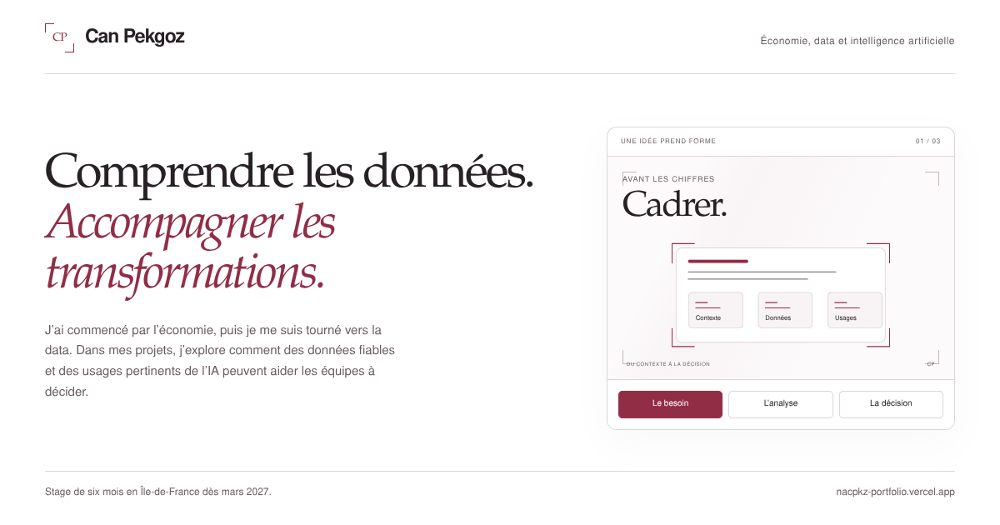

# Can Pekgoz — Portfolio

**Économie, data et transformation IA.**

Étudiant en Master BIDABI à l’Université Sorbonne Paris Nord, je cherche un stage de six mois à partir de mars 2027 en Île-de-France.

[Consulter le portfolio](https://nacpkz-portfolio.vercel.app/) | [Télécharger mon CV](public/assets/CV_Can_Pekgoz.pdf) | [Me contacter](mailto:canpekgoz.pro@gmail.com)

## Comprendre les données. Accompagner les transformations.

Ce portfolio présente ma démarche à travers des projets en analyse de données, Business Intelligence, modélisation et usages de l’IA. Chaque étude de cas précise la question métier, ma contribution, les résultats documentés et leurs limites.

## Projets présentés

| Projet | Question explorée | Repères |
| --- | --- | --- |
| [ConsultAI 360](https://github.com/NacPKZ/ConsultAI-360) | Comment fiabiliser les indicateurs et cadrer un usage IA utile ? | Quatre scénarios de qualité, plus de 4,1 millions de lignes synthétiques cumulées et un rapport Power BI en sept pages. |
| [Olist](https://github.com/NacPKZ/Olist-Ecommerce-Data-Warehouse) | Comment relier commandes, paiements et livraisons sans mélanger les niveaux de détail ? | Entrepôt PostgreSQL organisé en RAW, CLEAN et DW ; 99 441 commandes étudiées. |
| [NovaTel](https://github.com/NacPKZ/NovaTel-Customer-Churn-Analytics) | Quels profils présentent une attrition élevée et quelles pistes de fidélisation examiner ? | Analyse descriptive de 7 043 clients dans un rapport Power BI en six pages. |

Les chiffres sont tirés des sources de chaque projet. ConsultAI utilise des données synthétiques ; Olist et NovaTel reposent sur des jeux publics. Les résultats présentés ne constituent pas des gains réalisés en entreprise.

## Dans le portfolio

- Un accueil interactif en trois plans : cadrer, analyser et décider.
- Des études de cas avec captures agrandissables, chiffres sourcés et liens vers les livrables.
- Mon parcours, mes compétences et mes centres d’intérêt.
- Un brouillon de mail dont l’objet et le message restent modifiables pendant la navigation.
- Des versions française et anglaise ; le sélecteur affiche la langue active.

L’identité visuelle associe un fond blanc, des accents bordeaux et des cadrages inspirés du cinéma. Le mode sombre reste disponible. Les illustrations et le clap sont vectoriels, avec des animations distinctes et une présentation fixe lorsque le mouvement réduit est activé.

## Développement local

Environnement testé : Node.js 22 et npm.

~~~bash
npm ci
npm run dev
~~~

| Commande | Usage |
| --- | --- |
| `npm run dev` | Lancer le serveur de développement. |
| `npm run validate` | Vérifier TypeScript, ESLint et les tests automatisés. |
| `npm run build` | Produire le site dans `dist`. |
| `npm run preview` | Prévisualiser le build local. |

## Organisation

| Emplacement | Contenu |
| --- | --- |
| `src/Portfolio.tsx` | Navigation, langue et apparence. |
| `src/components/portfolio/` | Accueil, études de cas, parcours et contact. |
| `src/data/` | Profil, projets, compétences et sources. |
| `src/styles/portfolio-site.css` | Thèmes, mise en page et animations. |
| `public/assets/CV_Can_Pekgoz.pdf` | CV téléchargeable. |
| `public/assets/projects/` | Captures originales des projets. |
| `public/assets/fonts/` | Polices et licences. |

React et TypeScript assurent l’interface, avec Vite pour le développement et le build. Les illustrations SVG restent nettes quelle que soit leur taille d’affichage. Les préférences de langue et d’apparence sont conservées dans le navigateur.

## Publication et sources

La version principale est publiée sur Vercel depuis la branche `main`. Les changements passent par une branche de travail et une validation avant leur intégration.

- [Instructions de déploiement](docs/DEPLOYMENT.md)
- [Sources, périmètres et crédits](docs/SOURCES.md)

Les captures Power BI conservent leur apparence d’origine. Les polices sont accompagnées de leurs licences dans public/assets/fonts.
